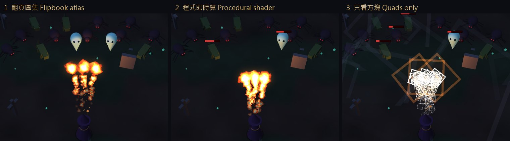
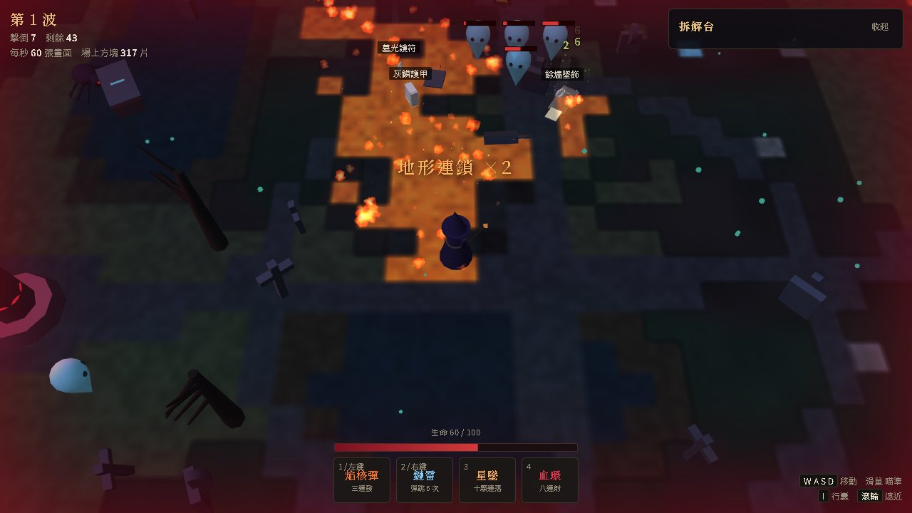
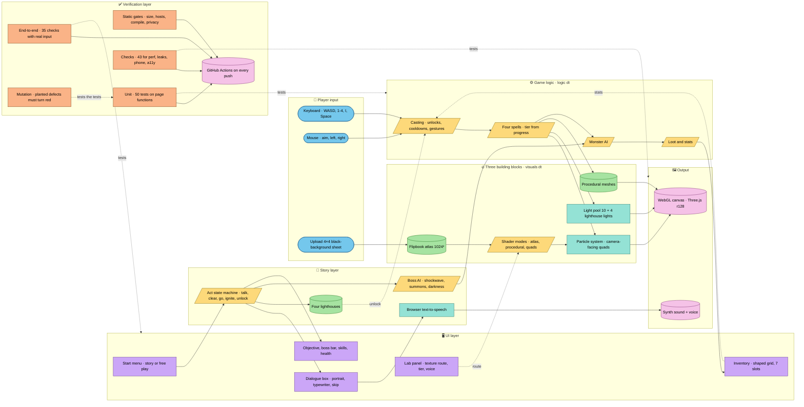
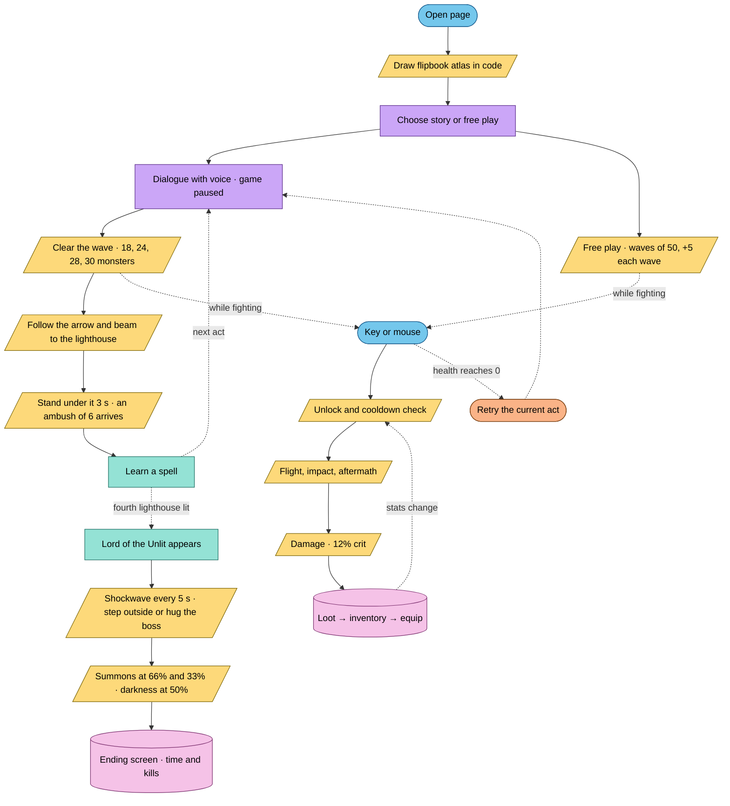
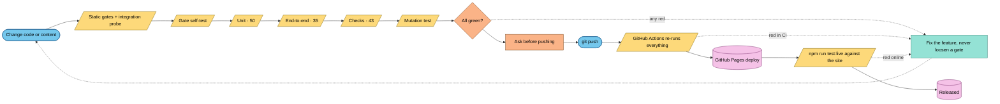

# Ember Graveyard · 燼語墓園

**Play in the browser → https://lee-unhn.github.io/ember-graveyard/** (keyboard + mouse)

[中文說明見下](#中文說明)

A single-file WebGL prototype that rebuilds four top-down 3D spells — fireball, chain lightning, meteor rain and a blood-rune barrage — using one decomposition method: **never paste a whole effect video into a 3D game; split every spell into flipbook textures, code-driven particles + lights, and 3D meshes, then let code decide when it fires, where it flies and where it explodes.** An in-game *Lab* panel switches between three texture routes live so you can compare them side by side.


| Same fireball, three texture routes |
|---|
|  |

## Two ways to play

- **Story mode · Chapter 1** (about 15 minutes) — you are an apprentice fire mage keeping a graveyard whose four lighthouses have gone dark. Clear each wave, stand under the next lighthouse to relight it, and every lighthouse teaches you one spell. Dialogue between waves has portraits and browser text-to-speech. The chapter ends with a boss, the Lord of the Unlit, who sends out expanding shockwaves, summons the dead and plunges the graveyard into darkness at half health.
- **Free play** — all four spells unlocked, endless waves, and the Lab panel to switch texture routes and basic/upgraded spells.

## Destructible terrain (P2)



The graveyard floor is an 88×88 grid of 15 terrain types (dry grass, grave soil, flagstones, puddles, mud, fire, ash, lava, craters, obsidian walls, charged water, blood pools, wisp graves, bone piles, steam). Inspired by the author's own [The-Waste-Land](https://github.com/Lee-unhn/The-Waste-Land):

- **Spells reshape the ground**: fireballs ignite grass and bone piles and boil puddles; chain lightning electrifies whole connected puddles; meteors punch lava craters and smash flagstones; the blood rune leaves slowing, damaging blood pools.
- **Terrain evolves on its own** every 0.2 s near the player: fire spreads and burns out to ash, lava flows into craters, meets water and hardens into obsidian walls, puddles fill craters, wisp graves blow up in chains.
- **Terrain kills**: fire, lava, charged water, blood pools, steam and explosions hurt monsters; only lava hurts you. Monsters killed by terrain drop extra loot 60% of the time, and terrain kills within 1.2 s build a **terrain chain ×N**.
- **Destructibles**: tombstones topple away from a blast and crush whatever is in their path, dead trees burn for 6 s and fall, fence sections break, sarcophagi crack open and release two ghosts plus a guaranteed drop. The Lord of the Unlit takes heavy damage standing in lava, and its shockwave knocks tombstones over.

## What it demonstrates

| Idea | How it shows up in the game |
|---|---|
| Three building blocks | Flipbook sheets (fire, explosion, smoke, sparks — 4×4 frames each), a GPU-instanced particle system with a fixed pool of 10 point lights, and procedural meshes (meteor rock, monsters, loot) |
| Billboards make it round | The fireball core is three overlapping camera-facing quads spinning at different speeds, plus a glow quad |
| Trail and impact numbers | 240 trail quads per second that shrink out within 0.1 s; 40 sparks with gravity and bounce on impact; a light that travels with the projectile |
| Three texture routes | **Flipbook atlas** (16 frames drawn once), **procedural shader** (noise computed per pixel, no images), **quads only** (outlines, to see the trick) |
| Bring your own atlas | Draw a black-background 4×4 sheet with any image model and upload it from the Lab panel; black turns transparent automatically |
| Basic → upgraded | single → triple fireball, single hit → lightning that chains 6 times, one meteor → 10-meteor rain |
| A small ARPG loop | 50 monsters per wave, damage numbers, health bars, loot beams, a shape-based grid inventory (staff 1×4, helmet 2×2, armour 2×3) and stats that change when you equip |

Everything — textures, rune circle, rock, sounds — is generated in code. No downloaded art assets.

## Controls

| Input | Action |
|---|---|
| `W A S D` | Move |
| Mouse | Aim |
| Left click / `1` | Fireball |
| Right click / `2` | Chain lightning |
| `3` | Meteor (lands at the cursor) |
| `4` | Blood rune barrage |
| `I` | Inventory (left click equip, right click discard) |
| Wheel | Zoom |
| `Space` / click | Next dialogue line |

## Architecture



## Gameplay flow



## Verification flow



Interactive versions with pan, zoom and a clickable mind map: open [`docs/diagrams/2026-11-15_EmberGraveyard/architecture.html`](docs/diagrams/2026-11-15_EmberGraveyard/architecture.html) locally (works offline). The first snapshot from launch day is kept in [`docs/diagrams/2026-11-15_EmberGraveyard_預設圖/`](docs/diagrams/2026-11-15_EmberGraveyard_預設圖/architecture.html).

## Development log

[`docs/DEVLOG.md`](docs/DEVLOG.md) records every request, decision, bug (symptom, how it was found, root cause, fix, the test that now guards it) and the release loop, as raw material for a course on building games with an AI coding assistant.

## Method notes and parameters

[`docs/METHOD.md`](docs/METHOD.md) — the full breakdown: building blocks, every number used (emitter rates, lifetimes, sizes, gravity), the three texture routes with cost notes, and image-model prompts for drawing your own 4×4 sheets.

## Run and test locally

```bash
python -m http.server 8794
```

Then open `http://localhost:8794`. Opening `index.html` directly also works.

```bash
npm test
```

Zero dependencies: Node 22+ and Chrome (or set `CHROME_PATH`). One command runs every suite, about 80 seconds:

| Suite | Command | What it proves |
|---|---|---|
| Smoke | `npm run test:smoke` | Static gates (size, allowed hosts, script compiles, privacy scan) plus an integration probe: four spells deal damage, three texture routes render, story mode runs from opening to ending |
| Unit | `npm run test:unit` | 50 tests on the page's own functions: noise, atlas borders and loop seam, particle pool, light pool, items and shaped inventory, damage and crits, spell locks, dialogue engine, story state machine, boss shockwave, every terrain reaction, the terrain automaton, wisp chain explosions, terrain kills and chains, toppling tombstones, burning trees, fences, sarcophagi |
| End-to-end | `npm run test:e2e` | 35 checks driven only by real keyboard and mouse events: start story, advance dialogue with Space, walk with W, cast with clicks and keys, equip from the inventory, die and retry, switch the Lab panel, set dry grass on fire with a click and watch it spread and kill |
| Checks | `npm run test:checks` | Performance budget under load (spells, and a 40×40 burning terrain field), no leaks across five restarts, no horizontal scroll at 375 px, accessible names, non-blank frames, documentation links, diagram sources in sync |
| Mutation | part of `npm test` | Copies the project, plants four known defects and requires the unit and check suites to turn red |
| Deployed site | `npm run test:live` | Re-runs smoke, unit, e2e and checks against GitHub Pages |

GitHub Actions runs `npm test` on every push and pull request.

## Roadmap

| Phase | Scope |
|---|---|
| P0 ✅ | Public repo, GitHub Pages, smoke harness, diagrams |
| P1 ✅ | Story mode chapter 1: four lighthouses, spell unlocks, dialogue with voice, the Lord of the Unlit |
| P2 ✅ | Destructible terrain and terrain kills: spells reshape the ground, terrain spreads and flows, tombstones topple onto monsters |
| P3 | New skin: low-poly characters with animation, image-model flipbooks compared side by side, better voices |
| P4 | Touch controls for phones |
| P5 | Port the fireball emitters to Godot and compare |

## Credits

- Method inspired by a video walkthrough of building top-down 3D spell effects with AI: https://www.youtube.com/watch?v=waaAXPt7RG8 . No footage or assets from the video are used; this project re-implements the idea from scratch.
- [Three.js](https://threejs.org/) r128 (MIT), loaded from cdnjs. Noto Sans TC / Noto Serif TC via Google Fonts (SIL OFL). See [NOTICE.md](NOTICE.md).
- Author: JasonLee ([Lee-unhn](https://github.com/Lee-unhn)). Code under the [MIT License](LICENSE).

---

## 中文說明

**瀏覽器直接玩 → https://lee-unhn.github.io/ember-graveyard/**（需要鍵盤與滑鼠）

單一 HTML 檔的 WebGL 試玩：用同一套拆解法做出四招俯視角 3D 法術（焰核彈、鏈雷、星墜、血環）。核心觀念是**整段特效影片不能直接放進 3D 遊戲**：每招都要拆成翻頁圖、程式控制的粒子與燈光、3D 模型三種零件，再由程式決定何時射、往哪飛、在哪炸。遊戲內的「拆解台」可以即時切換三條貼圖路線，並排比較效果。

### 兩種玩法

- **故事模式・第一章**（約 15 分鐘）：你是見習火術師，墓園的四座燈塔全熄了，亡者醒了過來。每一幕先清掉一波怪，再站到下一座燈塔下把它點亮，每點亮一座就學會一招法術。波次之間有附頭像的對白，並用瀏覽器內建語音朗讀。最後的首領是「無燈之主」：會放往外擴散的衝擊波、召喚亡者，血量剩一半時讓整座墓園陷入黑暗。
- **自由試玩**：四招全開、波次無限，可以用拆解台切換貼圖路線與基礎／升級法術。

### 地形破壞與地形殺（P2）


墓園地面是 88×88 格、15 種地形（枯草、墓土、石板路、積水、泥沼、火焰、灰燼、熔岩、坑洞、黑曜石牆、帶電水、血沼、磷火墳、骨堆、蒸氣），參考作者自己的 [The-Waste-Land](https://github.com/Lee-unhn/The-Waste-Land)：

- **招式改寫地面**：焰核彈點燃枯草與骨堆、把積水燒成蒸氣；鏈雷讓整片相連的積水帶電；星墜砸出熔岩坑、砸碎石板路；血環留下會減速又扣血的血沼。
- **地形自己演變**：每 0.2 秒掃一次玩家附近，火會蔓延、燒完變灰燼；熔岩流進坑洞，碰到水凝成黑曜石牆；積水流進坑洞；磷火墳會連鎖爆炸。
- **地形殺**：火、熔岩、帶電水、血沼、蒸氣與爆炸會傷怪物，只有熔岩會傷玩家。被地形殺死的怪物有 60% 機率多掉一件裝備，1.2 秒內連續地形擊殺累積「地形連鎖 ×N」。
- **可破壞物**：墓碑朝爆炸反方向倒下，壓死路徑上的怪物；枯樹著火燒 6 秒後倒下；柵欄可分段撞斷；石棺裂開會放出兩隻殘魂並必掉一件裝備。無燈之主站在熔岩上會受重傷，牠的衝擊波會推倒墓碑。

### 看得到的重點

| 觀念 | 在遊戲裡的樣子 |
|---|---|
| 三種零件 | 翻頁圖（火焰、爆炸、濃煙、光點，各 4×4 共 16 格）、一次畫完的粒子系統加上固定 10 盞的燈光池、程式捏出的模型（隕石、怪物、裝備） |
| 方塊永遠面向鏡頭 | 火球球心是三片疊在一起、轉速不同的方塊，再加一圈光暈 |
| 尾焰與命中的數字 | 尾焰每秒 240 片、每片 0.1 秒內縮小熄滅；命中炸出 40 顆會落地反彈的火星；一盞燈跟著火球飛、照亮地面 |
| 三條貼圖路線 | 翻頁圖集（16 格一次畫好）、程式即時算（每個像素用雜訊公式算，不用圖片）、只看方塊（只畫外框，看穿效果怎麼做出來） |
| 換上自己畫的圖 | 用任何繪圖模型畫一張黑底 4×4 圖，從拆解台上傳，黑色會自動變透明 |
| 基礎與升級 | 單發變三連發、單擊變彈跳 6 次、單顆隕石變十顆連落 |
| 小型動作遊戲循環 | 每波 50 隻怪、傷害數字、血條、掉寶光柱、照形狀占格的背包（法杖 1×4、頭盔 2×2、胸甲 2×3），穿上裝備數值會變 |

貼圖、法陣、石頭、音效全部由程式產生，沒有使用任何下載的美術素材。

### 操作

| 輸入 | 動作 |
|---|---|
| `W A S D` | 移動 |
| 滑鼠 | 瞄準 |
| 左鍵／`1` | 焰核彈 |
| 右鍵／`2` | 鏈雷 |
| `3` | 星墜（落在游標處） |
| `4` | 血環 |
| `I` | 行囊（左鍵穿上、右鍵丟掉） |
| 滾輪 | 鏡頭遠近 |
| `空白鍵`／點一下 | 下一句對白 |

### 架構圖與流程圖

上方三張 mermaid 圖（系統架構、遊戲流程、驗證流程）在 GitHub 上直接顯示。可縮放、可點選心智圖的互動版在 [`docs/diagrams/2026-11-15_EmberGraveyard/architecture.html`](docs/diagrams/2026-11-15_EmberGraveyard/architecture.html)，下載後離線開啟即可；上線第一天的版本保留在 [`docs/diagrams/2026-11-15_EmberGraveyard_預設圖/`](docs/diagrams/2026-11-15_EmberGraveyard_預設圖/architecture.html)。

### 開發紀錄

[`docs/DEVLOG.md`](docs/DEVLOG.md) 記錄每一個需求、決定、bug（症狀、怎麼發現、根因、修法、現在由哪個測試防止再犯）與上線流程，是之後做「用 AI 寫遊戲」課程的素材。

### 方法與參數

[`docs/METHOD.md`](docs/METHOD.md) 收錄完整拆解：三種零件、每個數字（發射頻率、壽命、大小、重力）、三條貼圖路線的成本比較，以及請繪圖模型畫 4×4 翻頁圖的提示詞。

### 本機執行與驗收

```bash
python -m http.server 8794
```

開 `http://localhost:8794`；直接雙擊 `index.html` 也可以。

```bash
npm test
```

不需安裝任何套件，只要 Node 22 以上與 Chrome（或設定 `CHROME_PATH`）。一個指令跑完全部，約 80 秒：

| 測試組 | 指令 | 驗什麼 |
|---|---|---|
| 煙霧測試 | `npm run test:smoke` | 靜態閘門（大小、外連網域、程式可編譯、隱私掃描）＋整合探針：四招都造成傷害、三條路線都能畫、故事模式從開場跑到結局 |
| 單元測試 | `npm run test:unit` | 50 項，直接測頁面裡的函式：雜訊、翻頁圖邊緣與循環接縫、粒子池、燈光池、裝備與照形狀占格、傷害與爆擊、法術鎖、對白引擎、故事狀態機、首領衝擊波、每一種地形反應、地形自動演變、磷火連鎖爆炸、地形殺與連鎖、墓碑倒下壓怪、枯樹燒倒、柵欄、石棺 |
| 端對端 | `npm run test:e2e` | 35 項，只用真實鍵盤滑鼠事件操作：進故事模式、空白鍵翻對白、按 W 走路、點擊與按鍵施法、從行囊穿裝、死亡重來、切換拆解台、點一下燒起枯草並看火勢蔓延燒死怪物 |
| 其他驗證 | `npm run test:checks` | 高負載效能預算（法術，以及 40×40 整片燃燒的地形）、重開五次無洩漏、375 像素寬無水平捲動、無障礙名稱、畫面非空白、文件連結、圖源同步 |
| 突變測試 | 包在 `npm test` 裡 | 複製一份專案、故意埋四個已知缺陷，單元與其他驗證必須變紅 |
| 線上版 | `npm run test:live` | 對 GitHub Pages 重跑煙霧、單元、端對端、其他驗證 |

每次推送與 pull request，GitHub Actions 都會自動跑 `npm test`。

### 階段規劃

| 階段 | 內容 |
|---|---|
| P0 ✅ | 公開 repo、GitHub Pages、驗收工具、架構圖與流程圖 |
| P1 ✅ | 故事模式第一章：四座燈塔、法術解鎖、有語音的對白、首領無燈之主 |
| P2 ✅ | 地形破壞與地形殺：法術改寫地面、地形會蔓延流動、墓碑倒下壓死怪 |
| P3 | 換皮：附動畫的低多邊形角色、用繪圖模型畫的翻頁圖並排實測、更好的語音 |
| P4 | 手機觸控操作 |
| P5 | 把火球發射器移植到 Godot 並排比較 |

### 致謝與授權

- 方法參考一支示範影片：https://www.youtube.com/watch?v=waaAXPt7RG8 。本專案沒有使用影片中的任何畫面或素材，全部從頭實作。
- [Three.js](https://threejs.org/) r128（MIT），由 cdnjs 載入；字型 Noto Sans TC／Noto Serif TC 由 Google Fonts 提供（SIL OFL）。詳見 [NOTICE.md](NOTICE.md)。
- 作者：JasonLee（[Lee-unhn](https://github.com/Lee-unhn)）。程式碼以 [MIT 授權](LICENSE) 釋出。
