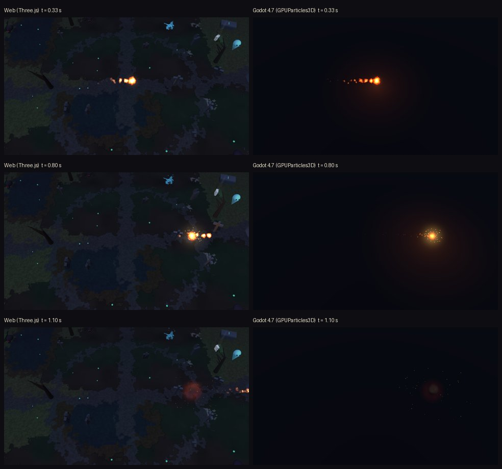

# Godot 移植對照 · Godot Port (P5)

> 把網頁版的火球（Three.js、自寫粒子系統）用同一份參數、同一套翻頁圖，在 Godot 4.7 的 GPUParticles3D 重建一次，並排比較。
> English summary: the web fireball rebuilt in Godot 4.7 with GPUParticles3D from the same parameter table (docs/METHOD.md §1) and the same flipbook frames, rendered with Movie Maker and compared frame by frame. Remaining differences are listed below.

## 做法

| 步驟 | 內容 |
|---|---|
| 引擎 | Godot 4.7.2 stable（官方 GitHub 發布，Windows 64 位元，SHA-512 與官方清單相符），Forward Plus 繪圖 |
| 共用素材 | `scripts/export_atlas.mjs` 把網頁版即時畫出的翻頁圖集匯出成四張 512×512 圖：火焰、爆炸、濃煙、光點，放在 `godot/textures/` |
| 場景 | `godot/main.gd` 用程式建好所有節點；鏡頭視角 42 度、位置與網頁版相同；火球從 x = −6.65 以速度 19 飛 0.7 秒後命中 |
| 出圖 | Godot 錄影模式固定每秒 30 格輸出 60 張；網頁版凍結自己的動畫迴圈，逐格推進同一條時間線 |
| 並排 | `scripts/compose_compare.py` 取 0.33 秒（飛行中）、0.80 秒（命中後 0.1 秒）、1.10 秒（煙與火星）三個時刻 |
| 重跑 | 環境變數 `GODOT` 設成 Godot 主控台版執行檔，然後 `node scripts/godot_compare.mjs` |

## 參數對照

| 零件 | 網頁版數值（METHOD.md §1） | Godot 欄位 |
|---|---|---|
| 球芯 | 3 片翻頁火焰、0.7–1.05、自轉、每秒 20–30 格 | `amount = 3`、`explosiveness = 1`、`local_coords = true`、`scale_min/max`、`angular_velocity_min/max`、`anim_speed` |
| 光暈 | 1 片、2.6、橘、透明度 0.32 | 同上，`color_ramp` 固定 0.32 |
| 尾焰 | 每秒 240 片、0.10–0.16 秒、0.5–0.66 → 0.05 | `amount = 240 × 0.16`、`lifetime_randomness`、`scale_curve`、`local_coords = false`（留在原地） |
| 火舌 | 每秒 70 片、0.2–0.3 秒、0.6 → 0.18 | 同上，`direction` 往上、`spread` 120 度 |
| 餘燼 | 每秒 35 顆、0.5–0.9 秒、往上飄、阻力 1.2 | `damping_min/max = 1.2`，固定用光點第 1 格 |
| 跟隨光源 | 橘 0xff7a2e、亮度 2.3、距離 8 | `OmniLight3D`：`light_energy`、`omni_range` |
| 命中爆炸 | 3 片爆炸翻頁、0.45–0.62 秒、2.5 → 3.7、壽命內播完 16 格 | `one_shot`、`anim_speed = 1`（一個壽命播完一張） |
| 命中火星 | 40 顆、速度 5–12、重力 16、阻力 1.4 | `gravity = (0, −16, 0)`、`initial_velocity_min/max` |
| 命中濃煙 | 6 團、一般混色、1.4 → 3.6、透明度 0.55 → 0 | `blend_mode = MIX`、`color_ramp` |

## 結果（2026-11-16）

| 項目 | 數字或觀察 |
|---|---|
| Godot 出圖 | 60 格 960×540 用 1–4 秒；顯示卡每格 0.2 毫秒 |
| 鏡頭 | 網頁版鏡頭實測位置 (0, 18.5, 11)、視角 42 度、畫面比例 16:9，與 Godot 相同 |
| 時間與位置 | 網頁版火球 0.33 秒在 x = −0.32（應為 −0.38）；兩邊 0.7 秒命中點一致 |
| 大小 | 爆炸翻頁圖、火星、光暈、濃煙的大小一致（修正過程見下一節） |

### 命中點周圍變亮的面積

量法：以命中點為中心、半徑 150 像素內，亮度比同一引擎沒有特效時高 20 以上的像素數（`scripts/compose_compare.py` 輸出的原圖，960×540）。網頁版每次執行有隨機粒子，數字會上下浮動約 5%。

| 時刻 | 網頁版 | Godot 第一版 | 修正粒子大小後 | 再修正疊加方式後（現行） |
|---|---|---|---|---|
| 0.33 秒（飛行中，火球周圍） | 1,704–1,849 | — | 4,195 | 3,097 |
| 0.80 秒（命中後 0.1 秒） | 5,889–6,038 | — | 16,687 | 8,938 |
| 1.10 秒（爆炸尾段） | 365–919 | 爆炸幾乎看不見 | 3,635 | 505 |

## 查明的原因

| 現象 | 原因 | 怎麼查到的 | 修正 |
|---|---|---|---|
| 爆炸翻頁圖偏小、火星偏大 | Godot 4.7 的粒子材質設成「面向鏡頭」時，預設會丟掉每顆粒子自己的大小，所有方塊都畫成 1 個單位：爆炸該 2.5–3.7 只剩 1，火星該 0.22 變成 1 | 另做一個只有白色方塊的場景，四個方塊分別設大小 2.5、2.5 加平坦曲線、2.5 加變大曲線、0.22 加縮小曲線，結果四個都是 42 像素寬；開啟 `billboard_keep_scale` 後變成 103、102→126、102、9→7 像素，與設定相符 | 材質加 `billboard_keep_scale = true` |
| 粒子被霧蓋暗 | Godot 的霧會套在粒子上；網頁版粒子用自寫著色器，沒有開霧 | 讀網頁版 `PSys` 原始碼：`ShaderMaterial` 沒有 `fog: true` | 粒子材質加 `disable_fog = true` |
| 光暈範圍大兩到三倍 | Godot 先把顏色換成線性光再相加、最後轉回螢幕色；網頁版（Three.js r128 沒開色彩管理）直接加螢幕色數值。透明度 0.05–0.2 的淡邊在 Godot 會亮好幾倍 | 0.80 秒：關掉 Godot 兩盞燈，面積 16,687 → 13,941；光點圖改成「顏色先乘透明度、透明度設 1」後再降到 6,442，接近網頁版 5,889 | 疊加用的三張圖（火焰、爆炸、光點）載入時先把透明度乘進顏色；濃煙是一般混色，不處理 |

## 尚未一致的地方

| 差異 | 觀察 | 原因 |
|---|---|---|
| 爆炸尾段偏暗 | 1.10 秒變亮面積 Godot 505、網頁版 365–919，紅色煙團看起來較淡 | 同一個「線性光相加」：三片淡色爆炸疊在一起時，線性光相加的結果比直接加螢幕色暗。上面的修正只讓單一片在黑底上一致，多片重疊無法用一般混色完全對齊 |
| 命中點周圍的地面光 | 0.80 秒 Godot 仍多約 3 成變亮面積 | 兩盞點光源（跟隨光、命中閃光）照在 Godot 素色地面上；兩個引擎的光線隨距離衰減公式不同，地面材質也不同（關燈實驗少掉約 2,700 像素） |
| 火星落地反彈 | 網頁版會反彈，Godot 版穿過地面 | Godot 要另外放碰撞節點才會反彈，這版沒有放 |
| 場景 | Godot 版只有素色地面 | 這次只比對特效，墓碑、地形、怪物沒有移植 |

## 對照過程中修正的設定

| 項目 | 第一版 | 修正後 |
|---|---|---|
| 火星與餘燼用的格子 | 隨機取光點表任一格，會取到大顆星形 | 第 9–16 格（網頁版 `frame: 8 + randi(0, 7)`） |
| 火星方向 | 往四面八方 | 偏向上方（網頁版把方向的垂直分量取絕對值） |
| 爆炸翻頁圖透明度 | 從 1 淡到 0 | 全程 1 |
| 命中點光源 | 沒有 | 亮度 4.5、照射距離 10、0.4 秒內熄滅 |
| 縮放曲線 | 上限 1，「變大」被截掉 | 上限依設定值放大 |
| 粒子大小 | 面向鏡頭時被丟掉，全部畫成 1 個單位 | `billboard_keep_scale = true` |
| 霧 | 粒子也被霧蓋 | 粒子不吃霧，與網頁版相同 |
| 疊加貼圖 | 原圖直接用 | 載入時透明度乘進顏色（`_web_additive`） |

`tests/checks.mjs` 會檢查 `godot/main.gd` 的粒子材質有沒有保留大小；突變測試第 8 個缺陷就是拿掉這一行，必須被抓到。
