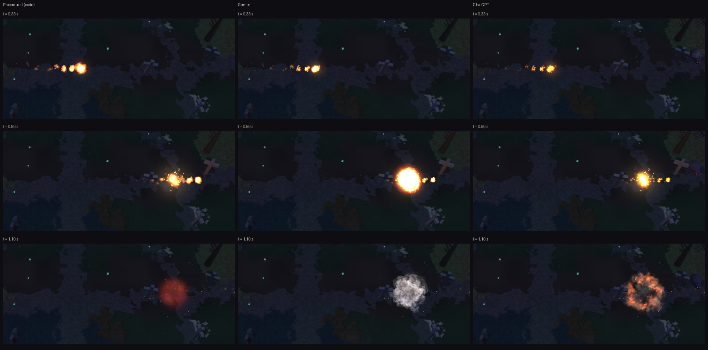
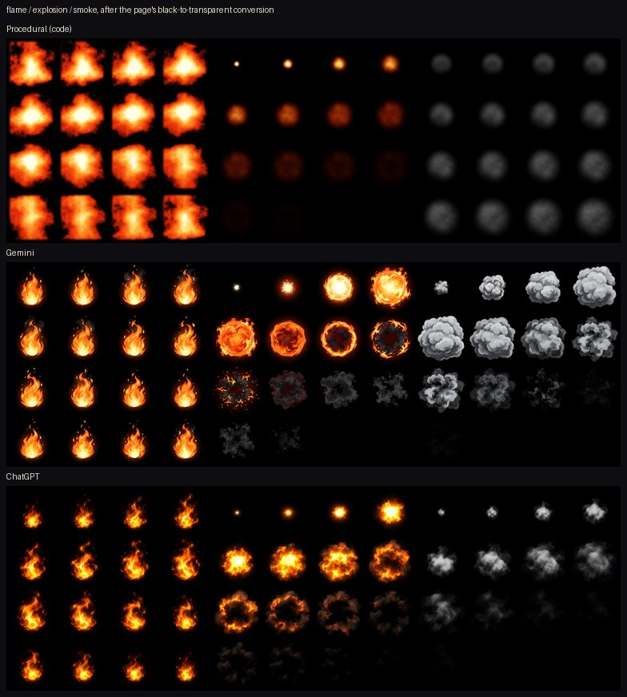

# 貼圖路線實測 · Flipbook Routes (P3c)

> 同一顆火球、同一段時間線，換上三組不同來源的翻頁圖並排比較：程式即時畫的、Gemini 畫的、ChatGPT 畫的。
> English summary: the same fireball and explosion rendered with three sets of 4×4 flipbook sheets: the page's procedural sheets, sheets drawn by Gemini, and sheets drawn by ChatGPT, all from the same prompt (docs/METHOD.md §6). Numbers below are measured from the sheets as the game uses them.





## 做法

| 步驟 | 內容 |
|---|---|
| 提示詞 | 兩邊都用 [METHOD.md](METHOD.md) §6 的同一份中文提示詞，火焰、爆炸、濃煙各一張；沒有重畫、沒有修圖 |
| 帳號 | 作者已登入的 Gemini（Pro）與 ChatGPT（Plus）網頁版，用既有訂閱額度，沒有另外付費 |
| 收圖檢查 | 照 METHOD.md §6：格數是否真的 4×4、有沒有格線或文字、內容有沒有碰到格子邊緣；6 張都通過 |
| 進遊戲 | 走遊戲自己的「換上自己畫的翻頁圖」流程（黑底轉透明），三組都一樣 |
| 出圖 | `node scripts/p3c_compare.mjs`：每組開一次頁面、亂數固定同一個種子、逐格推進同一條時間線（火球從 x = −6.65 以速度 19 飛 0.7 秒後命中），取 0.33、0.80、1.10 秒 |
| 原圖 | 放在 `incoming/p3c/`（不進版控）；重跑時檔名為 `gemini_flame.jpg`、`gpt_explosion.png` 這類格式 |

## 原圖規格

| 項目 | Gemini | ChatGPT |
|---|---|---|
| 尺寸與格式 | 2048×2048 JPEG，每張約 1.5–1.7 MB | 1254×1254 PNG，每張約 1.1 MB |
| 每張等待時間 | 約 20–30 秒 | 約 40–60 秒 |
| 進遊戲時 | 縮成 512×512（每格 128） | 同左 |

## 量測（轉成透明後的 512×512 圖）

| 組 | 圖 | 每格有內容的面積 | 格邊 8% 範圍內最亮值 | 最外 2 像素最亮值 | 相鄰兩格平均差異 | 第 16 格接回第 1 格的差異 |
|---|---|---|---|---|---|---|
| 程式畫 | 火焰 | 62.4% | 0.69 | 0 | 0.042 | 0.059 |
| 程式畫 | 爆炸 | 10.2% | 0 | 0 | 0.006 | — |
| 程式畫 | 濃煙 | 18.9% | 0 | 0 | 0.004 | — |
| Gemini | 火焰 | 29.7% | 1.00 | 0.01 | 0.026 | 0.024 |
| Gemini | 爆炸 | 30.7% | 0.96 | 0.04 | 0.062 | — |
| Gemini | 濃煙 | 27.2% | 0.84 | 0 | 0.063 | — |
| ChatGPT | 火焰 | 22.2% | 0.74 | 0.25 | 0.024 | 0.011 |
| ChatGPT | 爆炸 | 22.4% | 0.37 | 0.01 | 0.039 | — |
| ChatGPT | 濃煙 | 9.7% | 0.08 | 0.02 | 0.021 | — |

量法：

| 欄位 | 怎麼算 |
|---|---|
| 有內容的面積 | 每格亮度（紅綠藍取最大）超過 0.1 的像素比例，16 格平均 |
| 格邊 8% 範圍內最亮值 | METHOD.md §5 規定內容離格邊至少 8%；這欄是 16 格在這個邊框帶裡的最高亮度，0 表示完全沒進來，1 表示最亮 |
| 最外 2 像素最亮值 | 大於 0 表示內容碰到格子邊線，播放時鄰格的內容可能被取樣到 |
| 相鄰兩格平均差異 | 第 k 格與第 k+1 格每個像素的平均絕對差（0–1），數字越大，每格之間變化越大 |
| 第 16 格接回第 1 格 | 只對循環播放的火焰有意義；數字與「相鄰兩格平均差異」接近，表示接回第 1 格時的跳動和平常換格差不多 |

## 遊戲畫面裡看得到的差異

| 時刻 | 程式畫 | Gemini | ChatGPT |
|---|---|---|---|
| 0.33 秒（飛行中） | 火球最大、球芯偏白 | 火球較小，看得出一根根火舌的形狀 | 火球最小，邊緣較碎 |
| 0.80 秒（命中後 0.1 秒） | 小火球加火星 | 一整顆亮白的大火球 | 中等大小的亮黃火球 |
| 1.10 秒（爆炸尾段） | 淡紅色的一團 | 灰白色煙團 | 橘紅色的火環加焦黑 |

畫面差異的來源：

| 現象 | 原因 |
|---|---|
| 兩組 AI 圖的火焰在畫面上比程式畫的小 | 程式畫的火焰佔格子 62%，AI 畫的只佔 22–30%；遊戲裡每片的大小是固定的（METHOD.md §1），內容佔格子越少，看起來越小 |
| Gemini 在 1.10 秒是灰白色 | Gemini 的爆炸後半 8 格是灰色煙；遊戲的爆炸用疊加發光，灰色疊上去會變亮白 |
| ChatGPT 的火焰最外 2 像素有 0.25 的亮度 | 至少一格的火舌畫到格子邊線上 |

## 重跑

```bash
node scripts/p3c_compare.mjs
```

會讀 `incoming/p3c/` 裡找得到的組別（缺圖的組別會跳過並列出缺哪張），輸出 `docs/media/p3c-routes.jpg` 與 `docs/media/p3c-sheets.jpg`。
